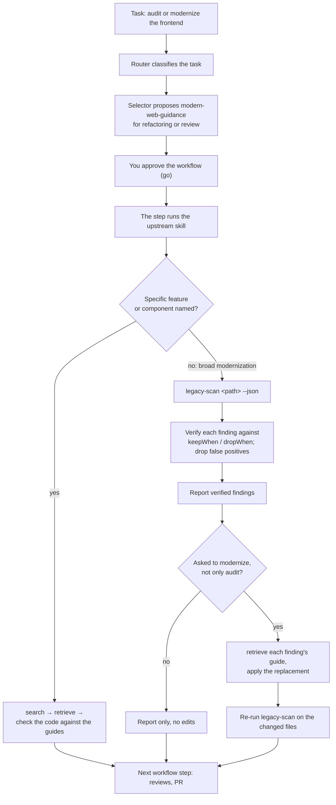

# Modern Web Guidance

[GoogleChrome/modern-web-guidance](https://github.com/GoogleChrome/modern-web-guidance) is a vendor source like the others ([adding a source](adding-a-source.md)), pinned under `vendors/modern-web-guidance`. It holds two skills, both in the [skill index](skill-index.md):

- `modern-web-guidance/modern-web-guidance`: current web platform guidance for client-side HTML, CSS and JavaScript (dialogs and popovers, forms and validation, layout and responsive CSS, accessibility, Core Web Vitals, HTML sanitization, browser support). It is the reason the source is here.
- `modern-web-guidance/chrome-extensions`: building and publishing Manifest V3 Chrome extensions. It is cataloged because every upstream skill must be; its signals are limited to Chrome extension work.

## How the skill works

The skill does not carry its guides in the prompt. It runs the upstream CLI through `npx` and loads only the guides that match the task:

```sh
npx -y modern-web-guidance@latest search "<2-5 word query>"
npx -y modern-web-guidance@latest retrieve "<id>[,<id>...]"
npx -y modern-web-guidance@latest legacy-scan <path> --json
```

`search` returns guide ids with descriptions, `retrieve` prints the full guides, and the agent checks its code against them and ends with a `### Modern Web Guidance` section naming the guides that shaped it. The router has no adapter around this CLI and does not import or vendor the guides: the pinned submodule holds the skill's instructions, while the guide content comes from the npm package at run time.

## Prerequisite: network access

`npx -y modern-web-guidance@latest` downloads the package from the npm registry, so the step needs outbound network access the first time and whenever a newer version is published. Upstream describes `search` itself as local (no network calls, no API keys) once the package is present, and its skill suggests `npx --offline …` when the command hangs offline. The catalog records the requirement in the entry's `requires`, and the selector treats it as a hard prerequisite: when the harness has no network access, the skill is left out with that reason. Without network access, swap it before `go`.

### `@latest` caveat

The skill always runs the latest published CLI, not a version this repo reviewed. The submodule pin and `catalog/reviewed.yaml` cover the skill's `SKILL.md`, not the guides or the CLI it downloads, so the guidance a run gets can change between two runs of the same workflow. Pinning the CLI version or vendoring the guides is out of scope here.

### Allowlisting the command

Upstream asks for an allowlist of exactly `npx -y modern-web-guidance@latest *` (or `pnpx modern-web-guidance@latest *`), never bare `npx *`, and for approval with network access before the first run, since sandboxed or approval-gated agents can otherwise time out.

**Claude Code**: in the target repo's `.claude/settings.json` (or your user settings):

```json
{
  "permissions": {
    "allow": ["Bash(npx -y modern-web-guidance@latest *)"]
  }
}
```

With the Bash sandbox enabled, also allow the registry under `sandbox.network.allowedDomains` (for example `"registry.npmjs.org"`).

**Codex**: a prefix rule in a `.rules` file under `.codex/rules/` in a trusted project (or `~/.codex/rules/`):

```starlark
prefix_rule(
    pattern = ["npx", "-y", "modern-web-guidance@latest"],
    decision = "allow",
    justification = "modern-web-guidance CLI: search and retrieve web platform guides",
)
```

A command fully matched by an `allow` rule runs outside the sandbox. To keep it sandboxed instead, enable network access in `workspace-write` with `[sandbox_workspace_write] network_access = true` in `config.toml`. If `~/.npm` is read-only in the sandbox, upstream suggests `NPM_CONFIG_CACHE=/tmp/npm-cache`.

## Categories it fills

The skill is tagged `research`, `refactoring`, `review` and `performance`:

- **research**: before frontend work, a step that consults the guides (search, retrieve) so the implementation starts from current platform patterns.
- **refactoring**: improving or modernizing an existing frontend codebase.
- **review**: auditing frontend code against current guidance.
- **performance**: Core Web Vitals and loading work.

### Why not `implementation`

The selector picks one skill per phase. Tagged `implementation`, this skill would compete with a frontend implementation skill such as `addyosmani/frontend-ui-engineering` and, if it won, replace it. As `research` it runs as a step before implementation and informs it instead. For an accessible modal, for example, research proposes modern-web-guidance and implementation stays with a frontend implementation skill.

### When it is not proposed

Its `avoid_when` signals keep it out of backend-only work (PHP/Laravel, ORM/Eloquent, SQL, API routes), infrastructure and tooling, and trivial edits such as a label change or a rename. For refactoring, it is not a reason to replace a working component with a native API just because one exists (an existing modal with `<dialog>`, say): a replacement is proposed only for a stated benefit (accessibility, maintenance, performance, fewer dependencies), and native replacements can change focus handling, Escape, scroll lock and stacking, so they need tests or browser verification.

## Modernizing through the router

The router has no `modernize` mode. A request such as "audit and modernize our frontend" is classified like any other task, and the selector proposes this skill for the matching phase (`refactoring` for a modernization, `review` for an audit). When that step runs, the upstream skill decides which of its flows applies:

- For a **specific** feature or component (add, update, fix or audit it), it uses its primary flow: search, retrieve, check the code against the guides. It does not run `legacy-scan`.
- For a **broad, open-ended** modernization or legacy-pattern scan with no named target, it runs its modernization flow: `legacy-scan <path> --json`, verification of each finding against its `keepWhen` / `dropWhen` rubric (dropping false positives such as fallbacks, cross-file helpers, vendor code and lookalikes), and a report of the verified findings. Upstream notes that `legacy-scan` covers only a curated subset (about 20%) of the guides. Only when you asked to modernize, not just to audit, does it retrieve each finding's guide, apply the replacement (keeping existing libraries as fallbacks where the guide requires one) and re-run `legacy-scan` on the changed files.



## Browser support

By default every guide assumes **Baseline Widely available** features are safe to use without fallbacks; for features that are not, the skill follows the guide's fallback recommendations. A project can set its own policy, which the skill then applies using each guide's compatibility data (for a `Baseline YYYY` target, a feature qualifies when its "Baseline since" year is at most `YYYY`). Write the policy in the target repo's `AGENTS.md` or `CLAUDE.md`, for example:

```markdown
**Browser Support:** Allow Newly Available features, but only adopt custom fallback code that adds <= 20 lines and no external dependencies.
```

Upstream suggests documenting such a policy when the project targets a restricted runtime (Electron, Tauri), excludes specific browsers, or hesitates over polyfill size. Guides for Origin Trial and volatile features are gated on `retrieve` unless a `.mwgrc` file in the project opts in.
